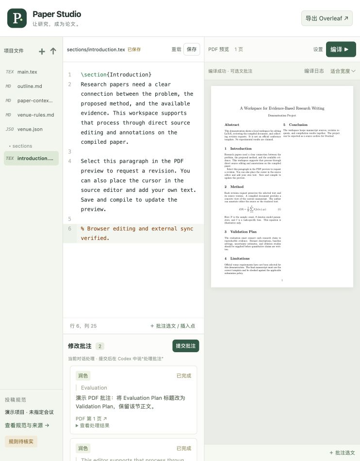

# LaTeX 论文工作台

一个在本地网页中写论文的 Codex skill：文件树、LaTeX 源码编辑、真实 PDF 编译预览、选文批注、Agent 修改，以及 Overleaf 源码包导出。



## 使用流程

1. 首次调用先确认会议/期刊、年份、track、文章类型、审稿版或终稿版，以及是否已有模板。
2. 用户提供模板就采用；未提供时由 Agent 检索官方网站下载模板，把格式、页数、匿名、引用、AI 写作披露等要求和来源记录到工作区。
3. 根据标题、研究方向、已有大纲及真实实验材料组织论文结构，再按章节写作。
4. 在网页中编辑源码、编译 PDF；在源码或 PDF 文字层选文，添加标签和修改要求，提交给 Agent。
5. 修改后重新编译并检查相关规则，最后导出可上传 Overleaf 的 ZIP。

官方要求优先于通用写作建议。未核实规则明确标注，不把“编译通过”当作“符合全部投稿规定”；不虚构结果、引用或 DOI。

## 安装到 Codex

```bash
git clone https://github.com/Yulia2233/overleaf-skill.git
mkdir -p "${CODEX_HOME:-$HOME/.codex}/skills"
cp -R overleaf-skill/latex-paper-studio "${CODEX_HOME:-$HOME/.codex}/skills/"
```

如果同名 skill 已安装，先备份或比对后更新。新对话中调用：

```text
使用 $latex-paper-studio 帮我创建论文项目，先确认投稿目标、模板和研究内容，再打开网页工作台。
```

完整行为说明见 [SKILL.md](latex-paper-studio/SKILL.md)。该 skill 运行在本机，不需要把论文上传到公共服务器。

## 运行依赖

- Python 3.10+，后端仅用标准库。
- `latexmk` 和模板所需的 `pdflatex`、`xelatex` 或 `lualatex`；`synctex` 用于 PDF 到源码的候选定位。
- 可使用 macOS 的 MacTeX，或 Linux 的 TeX Live。当前后端使用 POSIX 文件锁，支持 macOS/Linux；Windows 请用 WSL。
- 普通使用无需 Node.js、npm 或 CDN；前端文件已打包。
- 自动修改模式额外需要已安装并登录的 Codex CLI；当前对话处理模式不需要单独的 CLI。

例如在 Debian/Ubuntu 安装基本依赖：

```bash
sudo apt-get install python3 latexmk texlive-latex-base texlive-latex-recommended texlive-latex-extra texlive-fonts-recommended
```

模板需要 XeLaTeX、LuaLaTeX、中文或特定 bibliography 工具时，按模板说明补装对应 TeX Live 包。

## 独立运行演示

以下命令在仓库根目录执行，论文项目放在仓库外的独立目录中：

```bash
python3 latex-paper-studio/scripts/studio.py init --project ../paper-demo --demo
python3 latex-paper-studio/scripts/studio.py serve --project ../paper-demo --port 0
```

打开终端打印的完整本地 URL，在网页点击「编译」。演示使用通用模板，不是正式会议模板。

使用已有官方模板：

```bash
python3 latex-paper-studio/scripts/studio.py init \
  --project ../my-paper --template /path/to/official-template.zip \
  --main main.tex --engine pdflatex
```

保留 ZIP 内原有目录结构，`--main` 应是解压后真实的入口相对路径。已有工程则用 `configure`，不会覆盖正文：

```bash
python3 latex-paper-studio/scripts/studio.py configure \
  --project ../my-paper --main main.tex --engine xelatex
python3 latex-paper-studio/scripts/studio.py serve --project ../my-paper --port 0
```

## 批注如何交给 Agent

选中源码或 PDF 文字 → 添加批注 → 选择标签并填写要求 → 保存批注 → 提交批注。

**默认：当前对话处理。** 提交后在 Codex 对话中说“处理批注”。网页保存持久队列，但不会自动唤醒已结束的对话。

**可选：本地自动处理。** 启动时加 `--agent codex`：

```bash
python3 latex-paper-studio/scripts/studio.py serve --project ../my-paper --agent codex
```

自动模式使用用户已登录的 Codex CLI 和模型配置，可能消耗该账户的使用额度。它在项目副本中处理批注；新稿编译成功、模板未被更改且原项目没有并发编辑时才合回。失败或冲突保留候选，避免覆盖作者修改。

源码批注记录版本和上下文；PDF 批注记录选文、页码、位置和编译版本。SyncTeX 提供近似位置，Agent 仍需核对原文。图片或扫描 PDF 没有可选文字时，使用源码批注。编译失败会保留上次成功 PDF，并明确显示旧预览。

服务仅绑定 `127.0.0.1`。启动 URL 含本地会话凭证，不要公开转发。编译不加载项目 `latexmkrc`，不启用 shell escape；依赖任意外部命令的模板需要先调整为官方允许的兼容方案。

## 导出到 Overleaf

点击网页的「导出 Overleaf」，或执行：

```bash
python3 latex-paper-studio/scripts/studio.py export \
  --project ../my-paper --output ../my-paper-overleaf.zip
```

在 Overleaf 选择 **New Project → Upload Project**，上传 ZIP，按包内 `OVERLEAF-IMPORT.md` 设置主文件、编译器与 TeX Live 版本。源码、图、参考文献、类和样式保留；批注、日志、历史及编辑笔记不进入导出包。

本地编译结果不代表已经在 Overleaf 云端验证。此仓库不自动登录、上传、共享或投稿，也不隶属于 Overleaf。

## 写作方法与授权

内置 [Master-cai/Research-Paper-Writing-Skills](https://github.com/Master-cai/Research-Paper-Writing-Skills) 的原始方法、章节指南和例文，固定版本为 `77e7c2c1ba06f7d71844873147665437a03aac1b`。原项目的方法整理自 Peng Sida 的公开笔记，面向 ML/CV/NLP。

核心方法包括：先小纲后正文、一段一个主旨、首句表达段落目的、反向大纲、主张与证据对应、五维审稿人自审。按具体章节加载指南，避免将例文结果当作用户结果。

- [集成写作方法](latex-paper-studio/references/writing-method.md)
- [原始 skill 文本](latex-paper-studio/references/upstream/research-paper-writing/UPSTREAM-SKILL.md)
- [来源与版本](latex-paper-studio/references/upstream/SOURCE.json)
- [原项目 MIT 许可](latex-paper-studio/references/upstream/LICENSE)
- [前端依赖许可](latex-paper-studio/assets/vendor/THIRD-PARTY-LICENSES.txt)

原始 `SKILL.md` 保留内容并重命名为 `UPSTREAM-SKILL.md`，防止技能扫描器把内置参考资料注册成第二个 skill。第三方材料适用各自许可；本仓库新增代码暂未另行声明许可证。

## 开发和验证

```bash
python3 latex-paper-studio/scripts/test_studio.py
cd latex-paper-studio/assets
npm ci
node build.mjs
```

前端构建需要 Node.js 22.13+，使用锁定版本的 CodeMirror、PDF.js 和 esbuild。`node_modules` 不随仓库分发。

测试包含版本冲突、Unicode 选区、模板路径安全、旧 PDF、失败编译、源码包重编译和自动处理协议；自动模式测试使用本地替身，不调用付费模型。实际已在浏览器验证编辑、两侧批注、提交、修改回写与 ZIP 下载。详见 [验证记录](docs/validation.md)。
